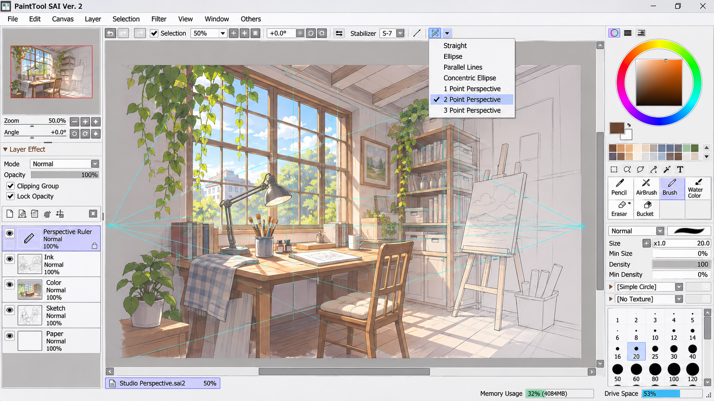
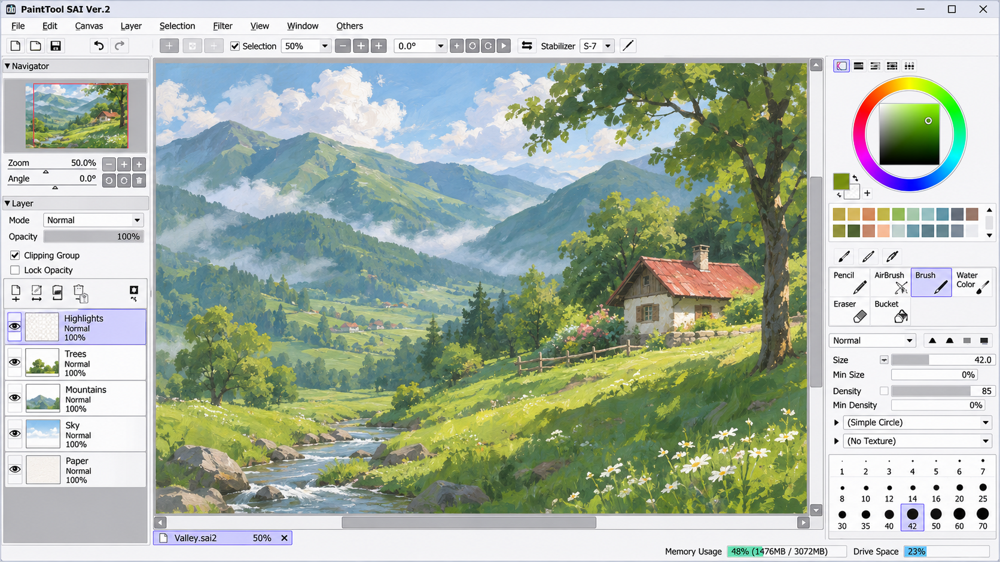
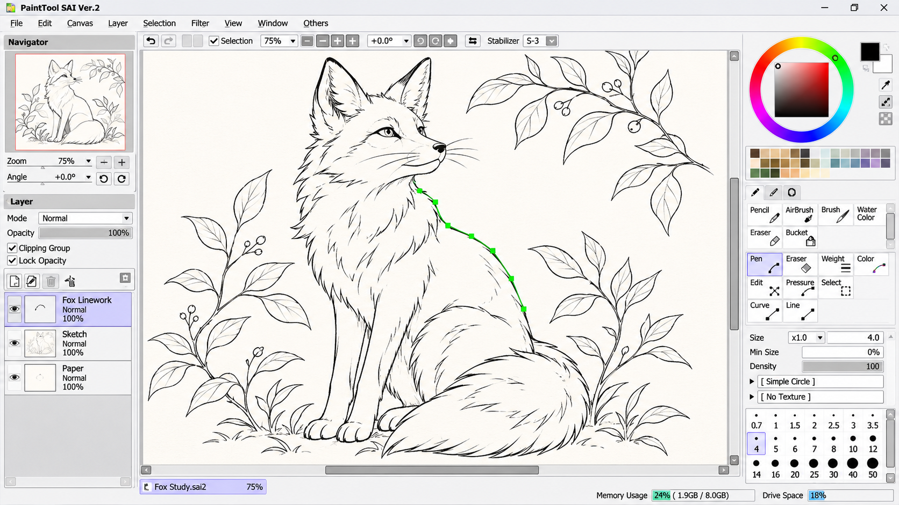

# Paint Sai - Smooth Browser Painting With Flexible Brushes

## Introduction

**Paint Sai** is a TypeScript raster painting project maintained by **Painttool Sai 2 Features**. It combines pressure-aware input, line smoothing, configurable brushes, layers, blending, selections, local project storage, and PSD workflows in a browser-oriented graphics editor.

## Features

- **Pressure-aware drawing:** The [pressure normalizer](src/app/script/bb/input/pressure-normalizer.ts) processes compatible pointer input for consistent brush behavior.
- **Line stabilization:** The [line smoothing](src/app/script/klecks/events/line-smoothing.ts), [line sanitizer](src/app/script/klecks/events/line-sanitizer.ts), and [stabilizer controls](src/app/script/klecks/ui/components/toolspace-stabilizer-row.ts) support controlled strokes.
- **Configurable brushes:** Pen, blend, sketchy, pixel, smudge, eraser, and experimental brush implementations are available under [brushes](src/app/script/klecks/brushes/brushes.ts).
- **Brush blending:** The [blend brush](src/app/script/klecks/brushes/blend-brush.ts), [smudge brush](src/app/script/klecks/brushes/smudge-brush.ts), and [mix-mode logic](src/app/script/klecks/canvas/get-mix-mode.ts) provide paint-like color interaction.
- **Layer composition:** The [layer compositor](src/app/script/klecks/canvas/layer-compositor.ts) and [clipping-group logic](src/app/script/klecks/canvas/get-clipping-groups.ts) handle layered raster projects.
- **Canvas operations:** Paint Sai includes flood fill, gradients, shapes, text rendering, transforms, and selection support.
- **Undo history:** Tile-based history records changed regions while trimming older entries to manage memory use.
- **Local storage:** Projects can be converted, stored locally, recovered, exported as PSD data, or saved to the computer.
- **Pointer and touch input:** Gesture, keyboard, pointer, pressure, and wheel handlers support desktop and tablet-style interaction.
- **Local processing:** Painting and project conversion occur in the browser without requiring routine server-side image processing.

### Is PaintTool SAI still good?

PaintTool SAI remains useful for artists who value a lightweight Windows workflow, responsive freehand drawing, smooth stabilization, tablet pressure, and natural brush blending. Its focused interface can be easier to learn than larger graphics suites.

The **Painttool Sai 2 Features** project concentrates on similarly important interaction patterns. Painttool Sai pressure sensitivity is represented through normalized pointer data, while Painttool Sai line stabilization is represented through stroke sanitation, smoothing, and stabilizer controls. Painttool Sai brush blending is reflected in dedicated blend and smudge implementations.

Artists should evaluate file compatibility, operating-system support, required native features, and their preferred workflow before choosing either one.

### Is PaintTool SAI 1 or 2 better?

PaintTool SAI 1 is appropriate for users who depend on its established workflow and existing configuration. PaintTool SAI 2 is generally the more suitable choice for users seeking continued development and its expanded feature set.

The **Painttool Sai 2 Features** organization emphasizes Painttool Sai 2 features, including modern brush behavior, layered composition, and stabilized input concepts. Painttool Sai vector layers are not reproduced as native SAI vector-layer semantics in this repository; the available [shape operation](src/app/script/klecks/image-operations/shape-tool.ts) works within the project’s browser painting architecture.

The better version depends on document compatibility and required functions. Existing artists should test their files and preferred brushes before changing versions.

## Repository Status

| Area | Status |
| --- | --- |
| Canvas foundation | Included |
| Pressure input | Included |
| Line smoothing | Included |
| Brush engines | Included |
| Layer composition | Included |
| Local project storage | Included |
| PSD conversion | Included |
| Native SAI file compatibility | Not claimed |

## Artist Vocabulary

paint sai, painttool sai 2 features, painttool sai brush settings, painttool sai vector layers, painttool sai line stabilization, digital-painting, raster-graphics, drawing-software, digital-art, brush-settings, line-stabilization, graphics-editor

## Browser Support

The **Paint Sai** architecture targets modern browsers with Canvas, Pointer Events, local storage, and the required graphics APIs.

- Chrome
- Firefox
- Edge
- Safari
- Other current Chromium-based browsers

Painttool Sai windows compatibility describes the official Windows application rather than a guarantee for this browser project. Painttool Sai wintab support likewise refers to native tablet integration in PaintTool SAI; **Paint Sai** uses browser pointer-pressure handling instead of directly calling Wintab.

## Download

### Is PaintTool SAI free?

The official PaintTool SAI is commercial software, not permanent freeware. Painttool Sai 31 day trial refers to its limited evaluation period, after which important operations such as opening and saving are disabled.

The source in **Paint Sai** has separate terms documented in [LICENSE](LICENSE).

### How expensive is PaintTool SAI?

The collected product information lists the official permanent license at 5,500 JPY, including Japanese sales tax. The final amount in another currency can vary with exchange rates, payment-provider conversion, and applicable regional charges.

Painttool Sai one time purchase describes the official perpetual-license model rather than a subscription.

## Files

Important **Paint Sai** entry points include:

- [Browser entry point](src/app/script/main-standalone.ts)
- [Application coordinator](src/app/script/klecks/kl.ts)
- [Application configuration](src/app/script/klecks/kl-config.ts)
- [Shared application types](src/app/script/klecks/kl-types.ts)
- [Canvas implementation](src/app/script/klecks/canvas/kl-canvas.ts)
- [Brush registry](src/app/script/klecks/brushes/brushes.ts)
- [Brush-setting service](src/app/script/klecks/brushes-ui/brush-setting-service.ts)
- [Layer compositor](src/app/script/klecks/canvas/layer-compositor.ts)
- [History manager](src/app/script/klecks/history/kl-history.ts)
- [Project store](src/app/script/klecks/storage/project-store.ts)
- [Selection implementation](src/app/script/klecks/select-tool/select-tool.ts)
- [HTML shell](src/index.html)
- [TypeScript configuration](src/tsconfig.json)
- [Webpack configuration](webpack.config.js)

## Modules & Libraries

The **Painttool Sai 2 Features** codebase is separated into focused layers.

### Level 0: Foundation

The [base modules](src/app/script/bb/base/base.ts) provide browser, canvas, image-loading, save, and UI utilities. Mathematics modules supply lines, matrices, vectors, and procedural noise.

### Level 1: Input And Color

The input layer normalizes pointer pressure and coordinates gestures, keyboard events, pointer events, and wheel events. The [color module](src/app/script/bb/color/color.ts) provides shared color operations.

### Level 2: Brushes And Canvas

The brush layer defines Painttool Sai brush settings through shared brush contracts and individual brush engines. The canvas layer draws projects, composites layers, resolves clipping groups, translates blend behavior, and applies canvas transformations.

Painttool Sai clipping masks are represented by clipping-group composition. Painttool Sai preserve opacity should be evaluated against the compositor’s actual behavior because the repository does not claim exact compatibility with every official SAI blending rule.

### Level 3: History And Storage

The history layer records tile-level changes and rebuilds project state for undo and redo. The storage layer detects file headers, converts projects, works with PSD data, persists browser projects, and saves output locally.

### Level 4: Application

The application layer joins Painttool Sai canvas setup, tools, brushes, input, history, storage, and interface components into **Paint Sai**.

## Commands

- Initialize dependencies with `npm ci`.
- Start the development environment with `npm run start`.
- Build the standalone project with `npm run build`.

The available scripts and dependency versions are defined in [package.json](package.json) and locked by [package-lock.json](package-lock.json).

## Embed

The browser architecture can be integrated into a host page by building the application and presenting its generated entry page in an appropriately sandboxed frame or application shell. The host should explicitly decide which clipboard, storage, and file capabilities it grants.

## Build/Test/Install

Install a current Node.js and npm environment before working with **Paint Sai**. Restore the locked dependencies, run the development command, and use the production build command when preparing distributable browser assets.

The TypeScript compiler settings are in [src/tsconfig.json](src/tsconfig.json). Bundling is configured in [webpack.config.js](webpack.config.js), while [src/index.html](src/index.html) supplies the browser document.

Painttool Sai minimum requirements apply to the official native application and should not be treated as the browser requirements for this repository. Browser performance depends on canvas size, layer count, history depth, brush complexity, graphics support, and available memory.

## Issues

Bug reports should include reproducible steps, browser and operating-system details, input-device information, expected behavior, and observed behavior. Pressure or stabilization reports should also identify whether the device exposes pressure through browser Pointer Events.

## Support

Support requests for **Paint Sai** should identify the relevant subsystem, such as brushes, line smoothing, canvas composition, history, storage, or selection. Useful reports include a minimal project, exact actions, console output, and whether the problem persists with a clean local build.

## Contributing

Contributions should remain focused on the selected TypeScript architecture and preserve clear boundaries between input, brushes, canvas composition, history, and storage. Changes to Painttool Sai brush settings should account for pressure, smoothing, blending, and UI synchronization.

## Credits

**Paint Sai** is maintained under the **Painttool Sai 2 Features** organization. Its retained architecture reflects established ideas from browser painting applications and open-source graphics editors, including pressure-aware brushes, layered composition, local storage, undo history, and responsive canvas interaction.

## License

The repository license is available in [LICENSE](LICENSE).
